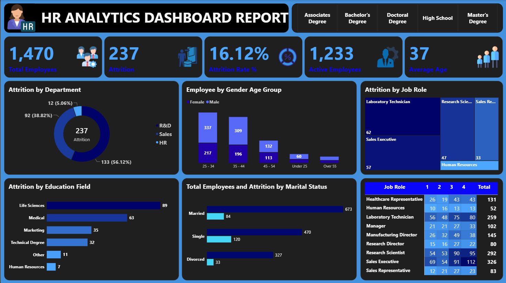

#  HR Analytics Dashboard Report — Power BI Dashboard

## 📌 Project Overview
This repository hosts an interactive **HR Analytics Dashboard Report** developed in **Microsoft Power BI**. The project transforms raw human resources records into visual insights covering workforce distribution, employee turnover drivers, marital status patterns, and role-level satisfaction ratings.

---

## 🖼️ Dashboard Preview

---

## Executive KPI Summary
| KPI Metric | Value | Workforce Scope |
| :--- | :--- | :--- |
| **Total Employees** | **1,470** | Full organizational headcount |
| **Attrition Count** | **237** | Total employees who exited |
| **Attrition Rate** | **16.12%** | Overall turnover percentage |
| **Active Employees** | **1,233** | Retained workforce strength |
| **Average Age** | **37** | Mean employee age in years |

The executive KPI cards track overall organizational retention alongside top-right interactive slicers for **Associates Degree**, **Bachelor's Degree**, **Doctoral Degree**, **High School**, and **Master's Degree**.

---

## 🛠️ Tools & Technical Workflow
* **Power Query (ETL & Data Cleaning):** Cleaned raw HR records, standardized categorical text labels, created custom age-group bins, and validated column data types.
* **DAX (Data Analysis Expressions):** Built calculated measures using `COUNTROWS` and `DIVIDE` to compute active headcount, turnover totals, and dynamic attrition percentages.
* **Interactive Visuals:** Designed cross-filtering visuals including a department donut chart, a job-role treemap, demographic bar charts, and a conditional-formatted heatmap table.

---

## Key Workforce and Attrition Insights

### Departmental Turnover
* **R&D Department:** Accounts for the largest share of exits with 133 departures, representing 56.12% of total attrition.   
* **Sales Department:** Records the second-highest turnover with 92 exits, making up 38.82% of departures.   
* **HR Department:** Shows the lowest turnover volume with 12 exits, or 5.06% of total attrition.

### Age and Gender Demographics
* **25 to 34 Cohort:** Represents the largest workforce segment with 337 male and 217 female employees.
* **35 to 44 Cohort:** Forms the second-largest age bracket with 309 male and 196 female staff members.
* **45 to 54 Cohort:** Comprises 132 male and 113 female employees across mid-to-senior career stages.
* **Entry and Senior Cohorts:** The Under 25 bracket includes 60 male employees alongside a smaller female cohort, while the Over 55 group represents the smallest workforce segment.

### Job Role and Education Field Attrition
* **High-Turnover Roles:** **Laboratory Technician** leads role-specific departures with 62 exits, followed by **Sales Executive** at 57, **Research Scientist** at 47, **Sales Representative** at 33, and **Human Resources**.   
* **Academic Backgrounds:** Employees from **Life Sciences** record 89 exits and **Medical** accounts for 63, followed by **Marketing** with 35, **Technical Degree** with 32, **Other** with 11, and **Human Resources** with 7.

### Marital Status Breakdown
* **Married Employees:** Represent the largest demographic at 673 staff members with 84 departures.
* **Single Employees:** Total 470 staff members while experiencing the highest turnover count at 120 exits.
* **Divorced Employees:** Account for 327 staff members and record the lowest turnover volume at 33 exits.

---

## Job Role Satisfaction Matrix
| Job Role | Scale One | Scale Two | Scale Three | Scale Four |
| :--- | :---: | :---: | :---: | :---:
| **Sales Executive** | 69 | 54 | 91 | 112 |
| **Research Scientist** | 54 | 53 | 90 | 95 |
| **Laboratory Technician** | 56 | 48 | 75 | 80 |
| **Manufacturing Director** | 26 | 32 | 49 | 38 |
| **Healthcare Representative** | 26 | 19 | 43 | 43 |
| **Manager** | 21 | 21 | 27 | 33 |
| **Sales Representative** | 12 | 21 | 27 | 23 |
| **Research Director** | 15 | 16 | 27 | 22 |
| **Human Resources** | 10 | 16 | 13 | 13 |

The matrix above distributes employee ratings from lowest to highest across nine roles, totaling 326 for **Sales Executive**, 292 for **Research Scientist**, 259 for **Laboratory Technician**, 145 for **Manufacturing Director**, 131 for **Healthcare Representative**, 102 for **Manager**, 83 for **Sales Representative**, 80 for **Research Director**, and 52 for **Human Resources**.

---

